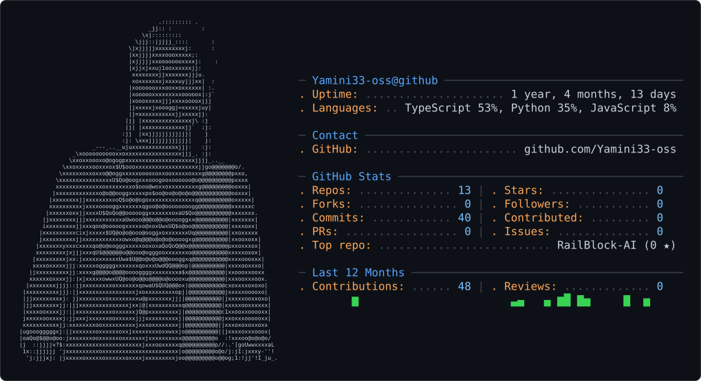

<picture>
  <source media="(prefers-color-scheme: dark)" srcset="dark_mode.svg" />
  <source media="(prefers-color-scheme: light)" srcset="light_mode.svg" />
  
</picture>

# Hi, I'm Yamini! 👋

AI/ML Student | Aspiring Software Developer

- 🎓 B.Tech in Artificial Intelligence and Machine Learning
- 💻 Interested in Java, SQL, AI/ML, and Full-Stack Development
- 🚀 Building projects like VERITAS AI and Campus Placement Analytics
- 📫 Reach me at: kotturiyamini@gmail.com

[GitHub](https://github.com/Yamini33-oss) · [LinkedIn](https://linkedin.com/in/yamini-priyadarshini-kotturi-0ba782323)
